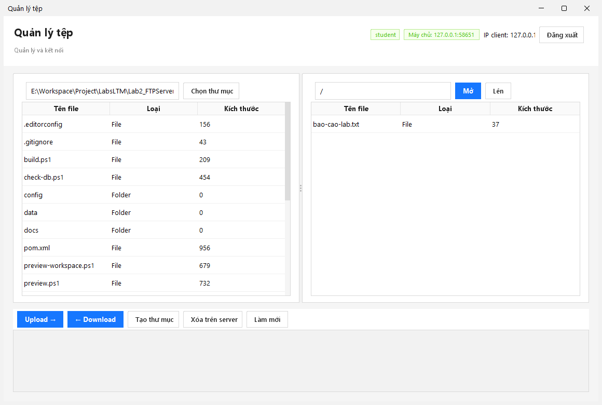

# Kết quả kiểm thử — Lab2_FTPServer

Ngày thực hiện: 2026-11-05. JDK 21.0.11, Maven 3.9.16, Windows 11, MySQL 8.0.30 dùng binary từ Laragon trong data directory tạm, port tạm 33317. Không khởi động/chỉnh sửa database Laragon hiện có. Đã có một lượt kiểm thử bổ sung trên MySQL container tách biệt trước đó.

## Tự động

**15/15 kiểm tra tích hợp đạt** qua test.ps1. FTP đăng ký/login; control/data channels; upload/download nhị phân; curl độc lập; account/file metadata/session IP trên MySQL; restart dữ liệu; start/stop/restart từ ServerController.

Server chạy tiến trình/socket/RMI thật, không mock giao thức. Mỗi run tạo schemas ltm_test_* riêng và dọn sau khi chạy, không dùng schemas demo của người dùng. Cấu hình test mặc định lấy config/database.properties; có thể override TEST_MYSQL_HOST/PORT/USER/PASSWORD. TEST_KEEP_DB=1 giữ schemas thử để quan sát thủ công.

Đã chạy SQL schema bằng MySQL CLI thật, bao gồm sql/schema-b.sql ở Lab 5. File này là cùng script người dùng mở trong HeidiSQL; chưa thao tác trực tiếp GUI HeidiSQL.

## UI Swing

- preview.ps1 render login/server dashboard, kiểm tra component tree không có JPasswordField.
- preview-workspace.ps1 mở client thật, đi qua nút đăng nhập/kết nối tới server và schema MySQL thử, render workspace với dữ liệu thực; đã xem ảnh để kiểm tra bố cục.
- Không thay các bước trên bằng ảnh mockup hoặc HTML UI.

[Login](client.png) · [Server dashboard](server.png)

## Cần làm tại môi trường chấm

Chưa chạy trực tiếp FileZilla. Cần demo trên LAN để kiểm tra passive data port.

Xem [hướng dẫn MySQL + HeidiSQL](MYSQL_HEIDISQL.md) và README tại folder lab. Các MySQL kiểm thử tạm đã được dừng sau khi kiểm tra; dự án vẫn mặc định MySQL Laragon port 3306.

## Cập nhật định dạng và điều khiển lưu — 2026-11-06

Source/test Java dùng tab width 4. test-save-options.ps1 đã kiểm chứng bản SaveOptions tạm có các dòng bật được comment; không thay source/jar mặc định. Xem DATABASE_WRITES.md để biết đúng file/dòng và ảnh hưởng khi tắt từng mục. Lượt kiểm tra cuối dùng MySQL tạm tại cổng/data directory riêng, schema thử riêng và không sửa cấu hình MySQL của ứng dụng.

