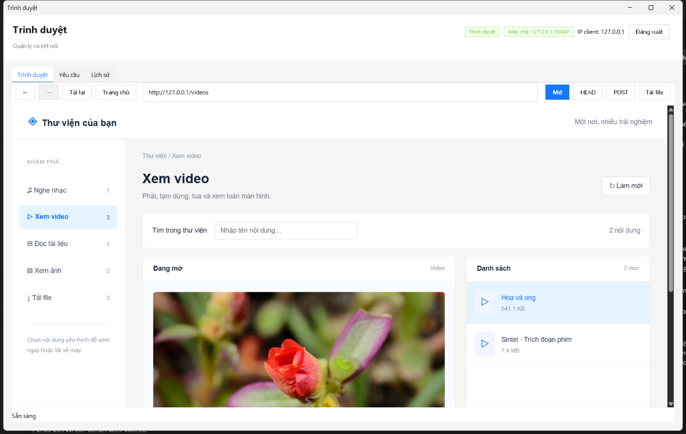

# Kết quả kiểm thử — Lab4_WebServer

Ngày thực hiện: 2026-11-05. JDK 21.0.11, Maven 3.9.16, Windows 11 x64, MySQL 8.0.30. Lượt mới nhất dùng MySQL Laragon đang chạy trên port 3306, với schemas ltm_test_* riêng và tự dọn. Các lượt trước từng dùng MySQL tại data directory/port tạm và container tách biệt. Không dùng bảng dữ liệu demo để chạy test.

## Tự động

**32/32 kiểm tra tích hợp đạt** qua test.ps1. GET/HEAD/POST, Content-Length theo byte; download nhị phân; byte range; request lỗi; history client và request IP/status tại server trong MySQL; start/stop/restart.

Server chạy tiến trình/socket HTTP thật, không mock giao thức. Mỗi run tạo schemas ltm_test_* riêng và dọn sau khi chạy. Cấu hình test mặc định lấy config/database.properties; có thể override TEST_MYSQL_HOST/PORT/USER/PASSWORD. TEST_KEEP_DB=1 giữ schemas thử để quan sát thủ công.

Đã chạy SQL schema bằng MySQL CLI thật, bao gồm sql/schema-b.sql ở Lab 5. File này là cùng script người dùng mở trong HeidiSQL; chưa thao tác trực tiếp GUI HeidiSQL.

## UI Swing

- preview.ps1 render login/server dashboard, kiểm tra component tree không có JPasswordField.
- preview-workspace.ps1 mở client thật, đi qua nút đăng nhập/kết nối tới server và schema MySQL thử, render workspace với dữ liệu thực; đã xem ảnh để kiểm tra bố cục.
- Không thay các bước trên bằng ảnh mockup hoặc HTML UI.

[Login](client.png) · [Server dashboard](server.png)

## Cần làm tại môi trường chấm

Đã thay file thử bằng bản thu Moonlight Sonata, WebM Hoa và ong/Sintel, ảnh NASA và khung hình hoa, PDF RFC 9110 nguyên bản, ZIP tài liệu. Trình duyệt thật nhúng trong ứng dụng Java hỗ trợ JavaScript, media và PDF. EC2 chưa triển khai thực tế; xem EC2.md.

Xem [hướng dẫn MySQL + HeidiSQL](MYSQL_HEIDISQL.md) và README tại folder lab. Các MySQL kiểm thử tạm đã được dừng sau khi kiểm tra; dự án vẫn mặc định MySQL Laragon port 3306.

## Kiểm tra thư viện trên trình duyệt

Lượt cập nhật thư viện dùng MySQL Laragon 3306 đang chạy, tạo schema ltm_test_* riêng và dọn lại sau test; không dùng bảng dữ liệu demo. 9 kiểm tra mới gồm danh mục, Unicode/URL, MIME và byte tải về bốn loại media, HEAD, cập nhật danh sách không restart, tải ZIP.

`tests/browser-smoke.cjs` đã chạy lại với nội dung thật bằng Playwright/Edge headless trên Windows, server Java/socket và schema MySQL thử: phát audio, phát/tua video, nhúng PDF, ảnh, tìm kiếm, tải ZIP so byte và màn hình 390px không tràn ngang. Không có lỗi JavaScript. Bản PDF thật đã kiểm tra pdfinfo (194 trang) và render trang đầu bằng Poppler.

Ảnh: [Nhạc](service-music.png), [Video](service-video.png), [PDF](service-documents.png), [Ảnh](service-photos.png), [Tải file](service-downloads.png), [Di động](service-mobile.png).

Browser test là công cụ phát triển tùy chọn, không cần Node/Playwright khi chạy ứng dụng. Để chạy lại: build, test.ps1, biên dịch tests/BrowserFixture.java với classpath jar/dependency và target/test-classes; chạy node tests/browser-smoke.cjs với Playwright có sẵn. TEST_BROWSER_CHANNEL mặc định msedge.

## Trình duyệt nhúng trong Java

**19/19 kiểm tra native UI đạt** bằng test-browser.ps1, dùng JCEF 152.0.6 trong client Swing thật, server HTTP socket và schema MySQL thử:

- Trang thực + JavaScript; bản thu Beethoven đúng nội dung.
- Audio phát, video hoa phát/tua, video Sintel có âm thanh phát.
- Ảnh NASA nguyên bản render, PDF mở bằng trình đọc tích hợp (đã xem ảnh có toolbar và trang tài liệu).
- Hộp thoại lưu ZIP thực, so sánh byte với file server.
- GET socket tự viết vẫn hoạt động, history client và request log MySQL có dữ liệu.
- Nút lùi/tiến hoạt động; logout/kết nối lại tạo browser mới.
- Không có lỗi Java UI không xử lý trong lượt kiểm tra cuối.

Đã xem ảnh native: [Nhạc](embedded-music.png), [Video](embedded-video.png), [PDF](embedded-pdf.png), [Ảnh](embedded-photos.png), [Tải file](embedded-downloads.png). Ảnh chụp từ cửa sổ ứng dụng đang chạy, không phải mockup.

Native Chromium có thể in log registry/USB của Windows khi khởi động; các dịch vụ và kiểm thử cuối vẫn đạt. Chưa kiểm tra client native trên Linux/macOS/Windows ARM. Server headless EC2 không dùng bộ hiển thị này.

## Cập nhật định dạng và điều khiển lưu — 2026-11-06

Source/test Java dùng tab width 4. test-save-options.ps1 đã kiểm chứng bản SaveOptions tạm có các dòng bật được comment; không thay source/jar mặc định. Xem DATABASE_WRITES.md để biết đúng file/dòng và ảnh hưởng khi tắt từng mục. Lượt kiểm tra cuối dùng MySQL tạm tại cổng/data directory riêng, schema thử riêng và không sửa cấu hình MySQL của ứng dụng.

Bổ sung kiểm tra HEAD liên tiếp sau connect, POST body thật, action DOWNLOAD và file byte chính xác; session server connect/disconnect/reconnect/timeout. Native UI bổ sung nút HEAD/POST, một phiên dùng chung với browser, download có session. Tổng Lab 4: 32 tích hợp + 13 công tắc lưu + 19 native UI.

Thanh địa chỉ trình duyệt nhúng ẩn cổng, nhưng giữ URL thực để điều hướng và HEAD dùng đúng cổng. Có 8 kiểm tra địa chỉ (nhập lại, đổi route, cổng khác, URL ngoài, IPv6, ký tự mã hóa) và kiểm tra trực tiếp thanh địa chỉ trong UI.

Đã sửa default document root của cả server GUI và CLI: WebPaths tìm public/index.html theo vị trí jar/classes trước, sau đó thư mục Lab4_WebServer trong working directory. Không tạo public rỗng rồi âm thầm trả 404 khi chạy từ IDE. Custom document root truyền qua CLI hoặc -Dlab.web.root vẫn được giữ. Hai kiểm tra mới khởi động tiến trình server từ thư mục tạm, xác nhận GET / trả đúng index.html và /music trả 200; tổng Lab 4 hiện 34/34 tích hợp và 8/8 địa chỉ.
